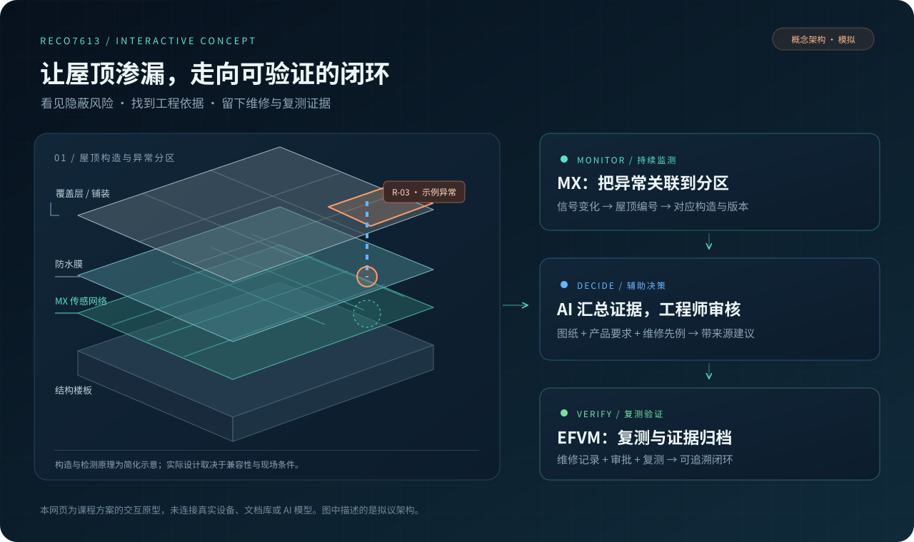
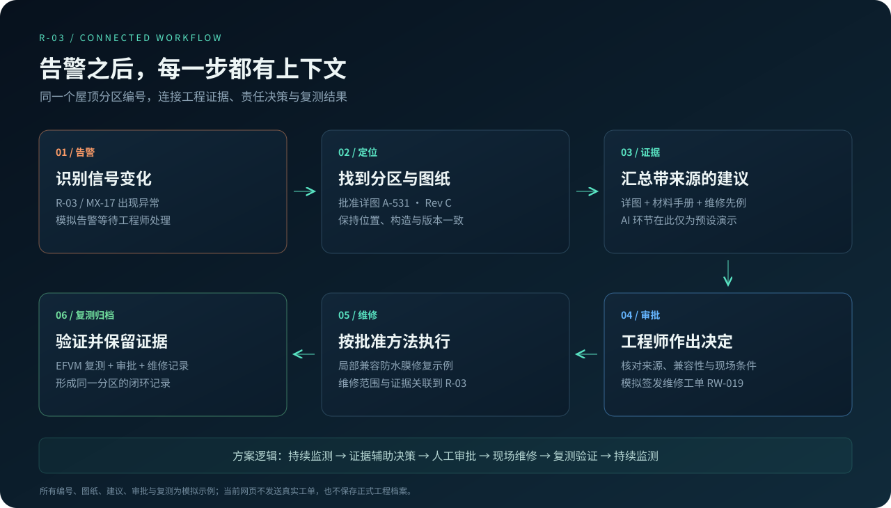
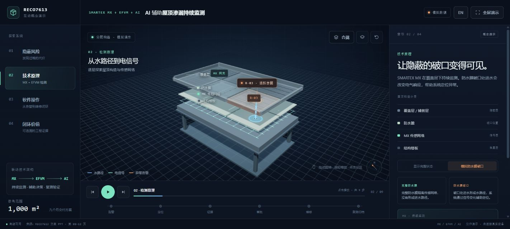
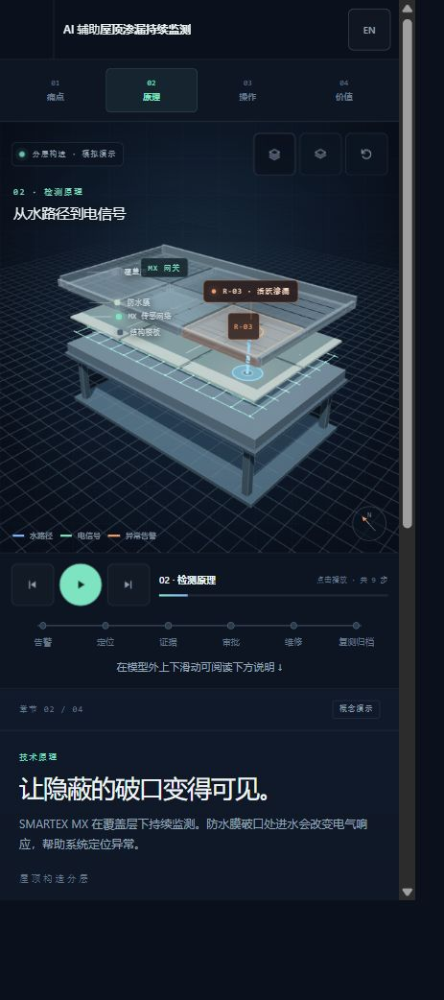

# AI 辅助屋顶渗漏监测 · 交互式 3D 演示

**把隐蔽渗漏、异常定位、工程证据和维修复测，放进同一个可交互的屋顶场景。**

这是一个面向覆盖式屋顶渗漏治理的课程方案演示：以 SMARTEX MX 持续监测、EFVM 检测与维修验证、AI 辅助证据汇总为设计主线，让工程师、业主和非技术观众直观看懂“为什么需要监测，以及告警之后怎么办”。

**[打开在线演示 →](https://ai-roof-leak-demo.pages.dev/)** · [查看源代码](index.html) · [部署与分享说明](DEPLOYMENT.md)

无需安装应用，无需注册账号。使用手机或电脑浏览器打开；3D 场景需要浏览器支持 WebGL。

> **原型边界：**本项目是前端交互与方案沟通原型。屋顶、传感信号、告警、图纸、维修建议、审批和复测结果均为预设模拟内容；当前没有连接真实传感设备、工程文档库或 AI 模型。界面中的“AI”展示拟议的证据工作流。



## 项目解决什么痛点

| 痛点 | 对工程管理的影响 | 本方案的设计回应 |
| --- | --- | --- |
| 覆盖层遮住防水膜，损伤难以直接观察 | 发现室内水渍时，水可能已扩散到完成饰面 | 以覆盖层下的持续监测概念，补充定期检查之间的信息空白 |
| 水渍位置与屋面破口位置可能不一致 | 排查依赖反复查找，维修范围难以快速界定 | 把异常映射到屋顶分区，在 3D 模型中展示位置关系 |
| 告警、图纸版本、材料要求和维修记录分散 | 工程师需要多处查找，容易遗漏版本与兼容条件 | 以屋顶分区编号连接告警、批准详图、产品要求和维修先例 |
| 完成维修后，验证与归档容易脱节 | 难以回答“是否修好、依据是什么、谁批准” | 把 EFVM 复测、维修证据和工程审批纳入同一闭环记录 |

## 创新点：把已有技术连成可追溯的流程

1. **持续监测与现场验证互补。**MX 对应持续追踪异常的设计角色；EFVM 对应现场检测与维修后的验证角色。演示用不同状态和动画解释二者的分工。
2. **一个分区编号串起工程证据。**以示例分区 `R-03` 为主线，将传感节点、告警、图纸版本、维修工单及复测记录放在同一上下文中。
3. **带来源的建议，保留人工审批。**拟议的 AI 环节负责汇总图纸、制造商要求和维修先例；工程师审核现场条件、材料兼容性和方法后作出决定。演示中的来源与建议为预设示例。
4. **把系统方案变成可操作的 3D 叙事。**使用构造分层、水路径、电信号和维修状态变化，让不同背景的观众共同理解方案。创新重点是集成流程与交互表达，相关效果仍需真实项目验证。

## 核心方案



| 环节 | 演示中的内容 | 实际落地时需要接入或确认 |
| --- | --- | --- |
| 1. 告警 | `R-03` / `MX-17` 出现模拟信号异常 | 设备数据、事件阈值、通信与告警规则 |
| 2. 定位 | 分区关联 `A-531 · Rev C` 及构造详图 | 经批准的图纸、坐标映射与版本管理 |
| 3. 证据 | 展示详图、材料手册和维修先例的引用 | 可检索文档库、引用核验与材料兼容规则 |
| 4. 审批 | 模拟工程师审核并签发 `RW-019` | 审核权限、现场判断与正式工单系统 |
| 5. 维修 | 模型显示局部修复范围及示例检查项 | 项目专项维修设计、施工与现场证据 |
| 6. 复测归档 | 模拟 EFVM 通过，展示关联闭环记录 | 真实复测结果、签认与长期档案保存 |

## 实际演示画面

### 电脑端



### 手机端



## 怎么体验

1. 打开[在线演示](https://ai-roof-leak-demo.pages.dev/)，通过右上角语言按钮切换中文或英文。
2. 在 **01 隐蔽风险** 中拖动屋顶，观察覆盖层下的水路径与室内渗漏关系。
3. 进入 **02 技术原理**，点击“分层”，比较完整防水膜与模拟破口的状态。
4. 进入 **03 软件操作**，点击 `R-03`，按按钮逐步体验“定位 → 证据 → 审批 → 维修 → EFVM 复测归档”。
5. 在 **04 闭环价值** 查看方案拟议的验收目标；也可点击播放按钮运行完整的 **9 步自动导览**。

手机上可单指旋转模型、双指缩放；在模型外上下滑动页面查看下方说明。电脑端支持鼠标拖动、滚轮缩放、俯视与复位。

| 电脑快捷键 | 操作 |
| --- | --- |
| `←` / `→` | 上一步 / 下一步 |
| `Space` | 播放 / 暂停导览 |
| `E` | 分层 / 合拢 |
| `R` | 复位当前视角 |
| `F` | 尝试全屏展示，取决于浏览器支持 |

## 技术实现

- **静态网页：**HTML、CSS、原生 JavaScript；无需后端、构建流程或 API Key。
- **3D 场景：**内嵌 Three.js 与 OrbitControls；包含屋顶分层、6 个分区、动态水路径、传感信号与模拟修复效果。
- **交互流程：**4 个章节、9 步导览、6 步模拟业务闭环，以及中英双语界面。
- **部署方式：**使用 `index.html` 作为入口，可托管于 Cloudflare Pages 或其他静态网站平台；源代码与项目说明公开保存在 GitHub。
- **运行依赖：**核心脚本与样式随网页提供，不需要访问外部脚本 CDN。网页依然需要成功加载托管域名，3D 渲染依赖设备与浏览器能力。

```text
ai-roof-leak-demo/
├── index.html                  # 网页入口与交互式 3D 原型
├── README.md                   # 公开项目说明
├── DEPLOYMENT.md               # 部署与分享说明
├── THIRD_PARTY_NOTICES.txt      # 第三方组件许可
├── system-overview.svg         # 核心方案图
├── closed-loop.svg             # 六步证据闭环图
├── desktop-demo.jpg            # 电脑端实拍截图
└── mobile-demo.jpg             # 手机窄屏截图
```

## 方案目标与验证边界

演示引用的以下指标是原方案的**拟议验收目标**，不是本网页已测得的性能，也不是对所有项目的保证。

| 目标项 | 演示显示的提案目标 |
| --- | --- |
| 检测能力 | ≥ 95% |
| 告警送达 | ≤ 15 分钟 |
| 图纸检索 Top 3 | ≥ 90% |
| 引用准确率 | ≥ 95% |
| 证据汇总耗时减少 | ≥ 30% |
| 闭环记录完整率 | 100% |

真实项目需定义样本、测试条件、统计口径及验收方法，再验证这些目标。页面中的 `1,000 m²` 和九个月周期属于提案参考范围；`500+` 与约 `23,000` 单位属于原提案所引用的背景案例，当前仓库未独立核验该案例，也未把它作为本系统的实测效果。界面中的示例工单、图纸和材料手册引用不代表可下载的真实工程文件。

目前的审批、维修和归档只改变演示状态，不会发送真实通知或工单，也不构成可长期保存的工程记录。实际系统设计还需确认防水膜兼容性、电气回路、现场构造、传感布置、权限、数据安全和维护责任。

## 来源与第三方组件

项目演示来源于 RECO7613 课程方案，原界面以章节标注方案 PPT 的参考页码。本仓库不包含该 PPT，也不以产品厂商名义发布。SMARTEX MX、EFVM 等名称用于解释方案涉及的技术角色；产品适用性需以正式技术文件与项目审核为准。

内嵌 Three.js / OrbitControls 的 MIT 许可与版权声明保留在源文件中。公开可查看源代码，不代表另行授予本项目整体的开源许可。
